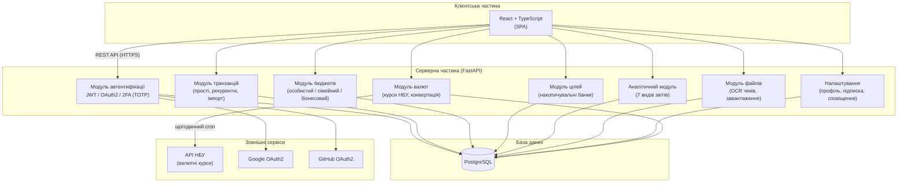

# Архітектура системи

## Опис компонентів

| Компонент | Технологія | Призначення |
|---|---|---|
| Клієнтська частина | React, TypeScript | SPA-інтерфейс, взаємодія через REST API |
| Серверна частина | FastAPI (Python, async) | Обробка запитів, бізнес-логіка |
| База даних | PostgreSQL | Постійне зберігання всіх даних |
| Автентифікація | JWT + TOTP + OAuth2 | Безпечний доступ до системи |
| Валютні курси | API НБУ | Актуальні курси, оновлення щогодини |
| Соціальний вхід | Google, GitHub OAuth2 | Швидка реєстрація / вхід |

